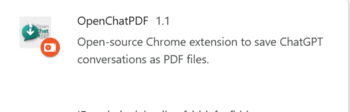
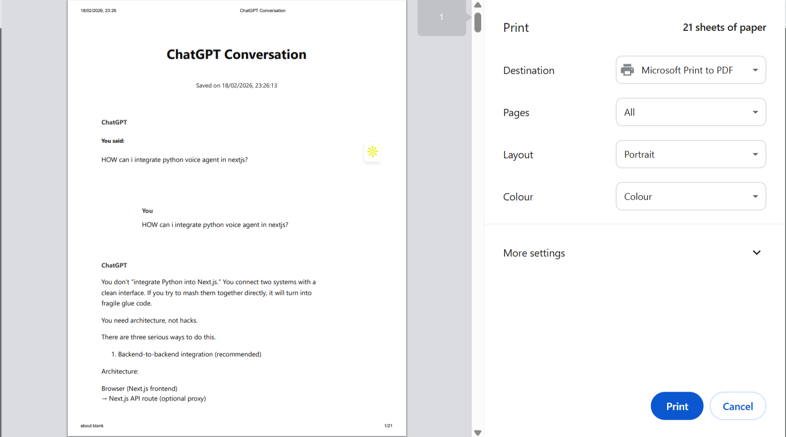

# OpenChatPDF

**Save conversations from ChatGPT, Claude, Gemini, Grok, DeepSeek & more as clean, readable PDFs — 100% locally, free & open-source.**

[](LICENSE)
[](https://github.com/Khan-1291/OpenChatPDF)
[](CONTRIBUTING.md)
[](https://github.com/Khan-1291/OpenChatPDF)

A lightweight Chrome (and Chromium-based browser) extension that adds a floating **"Save as PDF"** button to popular AI chat interfaces. Export entire conversations — including code blocks, markdown, math, and images — with clean formatting. No screenshots, no paid tools, nothing leaves your browser.

<p align="center">
  
</p>

---

## ✨ Features

- **One-click export** of the current conversation
- **Multi-LLM support** (v2):
  - ChatGPT (`chatgpt.com` / `chat.openai.com`)
  - Claude (`claude.ai`)
  - Gemini (`gemini.google.com`)
  - Grok (`grok.x.ai` / `x.com/i/grok`)
  - DeepSeek (`chat.deepseek.com`)
  - Perplexity (`perplexity.ai`)
  - Microsoft Copilot (`copilot.microsoft.com`)
- Preserves **code blocks**, markdown formatting, tables, images, and math
- Clean two-column style layout (You ↔ AI)
- Works **completely offline** — nothing is sent to any server
- No login, no tracking, no ads
- Open source under the **MIT license**

---

## 🚀 Installation

### Option 1: Chrome Web Store (coming soon)

Once published the link will appear here.

### Option 2: Install from GitHub (works immediately)

1. Go to the [**Releases**](https://github.com/Khan-1291/OpenChatPDF/releases) page  
   *(or just use the main branch files)*
2. Download the latest `.zip` (or clone the repo)
3. Unzip it to a folder, e.g. `C:\Extensions\OpenChatPDF` or `~/Extensions/OpenChatPDF`
4. Open Chrome → go to `chrome://extensions/`
5. Enable **Developer mode** (toggle in the top-right)
6. Click **Load unpacked** → select the folder you unzipped
7. Done! Visit any supported chat site — the green floating button appears in the bottom-right corner

<p align="center">
  
</p>

---

## 📸 Screenshots

| Floating button | Print → Save as PDF | Example output |
|-----------------|---------------------|----------------|
|  | *(add your screenshot)* | *(add your PDF preview)* |

*(Feel free to open a PR with better screenshots!)*

---

## 🛠 How to Build / Modify

```bash
git clone https://github.com/Khan-1291/OpenChatPDF.git
cd OpenChatPDF
```

No build step is required. The extension is pure Manifest V3 + vanilla JavaScript.

To test changes:

1. Make your edits (mainly `content.js` or `manifest.json`)
2. Go to `chrome://extensions/`
3. Click the refresh icon on the OpenChatPDF card
4. Reload the chat page

---

## 📁 Project Structure

```
OpenChatPDF/
├── manifest.json          # Extension manifest (MV3)
├── content.js             # Main logic – site detection + PDF generation
├── icon.png               # Extension icon
├── screen.png / screen2.png
├── LICENSE                # MIT
├── README.md
├── CONTRIBUTING.md
└── CODE_OF_CONDUCT.md     # (optional – recommended for growing projects)
```

---

## 🤝 Contributing

Contributions are **very welcome**!  

Whether you want to:

- Add support for a new AI chat site
- Improve message extraction selectors (sites change their DOM often)
- Polish the PDF layout / CSS
- Add dark-mode PDF theme
- Improve accessibility or keyboard shortcuts
- Write better documentation / screenshots

Please read **[CONTRIBUTING.md](CONTRIBUTING.md)** before opening a PR.

Quick tips that help the project grow:

- Use clear commit messages
- Open issues for bugs or feature ideas first
- Keep PRs focused (one feature / fix per PR)
- Test on the actual website before submitting

---

## 🏷 Suggested GitHub Topics / Tags

To help the repository get discovered, add these topics in the GitHub repo settings:

```
chrome-extension
pdf
chatgpt
claude
gemini
grok
deepseek
ai-chat
export-pdf
open-source
manifest-v3
browser-extension
conversation-export
local-first
privacy
```

---

## 📄 License

MIT License – see [LICENSE](LICENSE) for details.

Copyright (c) 2026 Zohaib Khan

---

## ⭐ Support the Project

If OpenChatPDF saves you time, please consider:

- Giving the repo a **star** ⭐
- Sharing it with friends who use AI chats daily
- Opening issues or PRs to make it even better

Thank you for using (and hopefully contributing to) OpenChatPDF!
